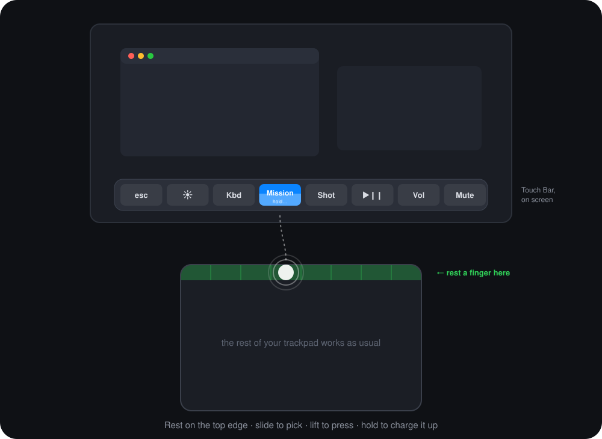
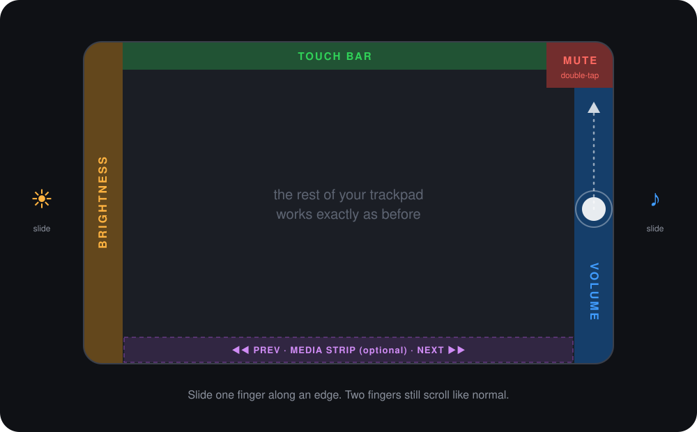

<p align="center">
  
</p>

<h1 align="center">Rimshot</h1>

<p align="center">
  <strong>The Touch Bar is back, on your trackpad.</strong>
</p>

<p align="center">
  
  
  
  
</p>

<p align="center">
  <a href="https://github.com/manankapoor23/rimshot/releases/latest/download/Rimshot.dmg"><strong>Download Rimshot for Mac</strong></a>
  &nbsp;·&nbsp; free &nbsp;·&nbsp; macOS 13 or later &nbsp;·&nbsp; <a href="#install">install notes</a>
</p>

Apple retired the Touch Bar, but the shortcuts were handy. Rimshot brings them back to every MacBook, including the ones that never had one.

Rest a finger on the top edge of your trackpad and a Touch Bar appears on screen. Slide to pick a button, feel a tick on each one, and lift to press. Your eyes stay on your work, with no glancing down at the keyboard.

## How it works

1. **Rest** a finger on the top edge of the trackpad. The bar fades in at the bottom of your screen.
2. **Slide** left or right. The highlight follows your finger, with a haptic tick on each new button.
3. **Lift** to press. Or press down on the trackpad to fire it right away.
4. **Hold** to charge it up. Stay on a button and the ticks come faster and stronger while a glow grows from the middle of the button out to its edges, then it fires on its own. On Brightness, Keyboard Light or Volume, a full charge turns the button into a slider you can drag. Hold <kbd>⇧</kbd> <kbd>⌥</kbd> while dragging for quarter steps.
5. **Changed your mind?** Slide down into the trackpad and let go.

## What's on the bar

| | Button | What it does |
|---|---|---|
| ⎋ | **esc** | Escape |
| ☀︎ | **Brightness** | Hold, then slide to adjust |
| ⌨︎ | **Keyboard Light** | Hold, then slide to adjust |
| ▦ | **Mission Control** | Shows all your windows |
| ⌖ | **Screenshot** | Opens the screenshot tool |
| ⏯︎ | **Play / Pause** | Media play and pause |
| 🔉 | **Volume** | Hold, then slide to adjust |
| 🔇 | **Mute** | Mute and unmute |

**Hold <kbd>fn</kbd> / 🌐 while using the bar** and it switches to **esc and F1–F12**, just like the Touch Bar did.

## Better than the original

- **You can feel it.** The Touch Bar was flat glass, so you had to look down. Rimshot gives a haptic tick on every button and a building rumble as a hold charges.
- **Eyes up.** The bar appears on your screen, next to what you're working on.
- **No accidental presses.** A quick touch does nothing. The bar only appears when you rest your finger, and you can always slide away to cancel. Taps on the bar never click whatever is under your cursor.
- **Works on every MacBook** with macOS 13 or later, including Airs that never had a Touch Bar.

## Bonus: media strip

<p align="center">
  
</p>

| Where | Gesture | What happens |
|---|---|---|
| **Bottom edge** *(optional)* | Swipe left or right | Previous / next track |
| **Bottom edge** *(optional)* | Tap | Play / pause |

Two-finger scrolling, clicking and every other gesture work exactly as before.

## Tiny, native, yours to read

- **Native Swift and AppKit.** The whole app is about 540 KB and uses about 30 MB of memory. No Electron.
- **0% CPU when idle.** Rimshot wakes up only when you touch the trackpad. The bar exists only while your finger is on the edge.
- **Open source.** Rimshot needs Accessibility permission, so you should be able to see what it does: it's about 1,300 lines of Swift in one file.

## Install

1. **[Download Rimshot.dmg](https://github.com/manankapoor23/rimshot/releases/latest/download/Rimshot.dmg)**, open it, and drag Rimshot into **Applications**.
2. Open Rimshot from Applications. macOS will say it *could not verify Rimshot is free of malware*. That's because the app isn't notarized by Apple yet, which requires a paid developer account. Click **Done**.
3. Open **System Settings → Privacy & Security**, scroll down to the message about Rimshot, and click **Open Anyway**. Confirm with your password or Touch ID.

You only do this once. If you're comfortable with Terminal, this does the same thing as step 3:

```bash
xattr -dr com.apple.quarantine /Applications/Rimshot.app
```

<details>
<summary><strong>Or build it yourself</strong> (no warnings, about 30 seconds)</summary>

You only need Apple's free Command Line Tools, not Xcode.

```bash
xcode-select --install          # skip if you already have the Command Line Tools
git clone https://github.com/manankapoor23/rimshot.git
cd rimshot && ./build.sh
mv Rimshot.app /Applications/ && open /Applications/Rimshot.app
```

Apps you build yourself aren't quarantined, so macOS won't show the warning.
</details>

### First launch

Rimshot asks for **Accessibility** permission the first time it runs. It needs this to send key presses to macOS the same way your keyboard does, and to keep taps on the bar from clicking whatever is under your cursor. Turn it on under **System Settings → Privacy & Security → Accessibility**, then relaunch Rimshot.

A slider icon appears in your menu bar. There's no Dock icon.

## Settings

Everything lives in the menu bar menu:

- **Top Edge** and **Touch Bar**: turn Touch Bar off to make the top edge a plain keyboard light slider instead.
- **Haptic Feedback**: the ticks and the charge-up rumble.
- **Media Strip** and **Tap to Play**: track controls on the bottom edge, off by default.
- **Open at Login**.

## See what Rimshot sees

Choose **Show Trackpad View** from the menu to open a live, to-scale map of your trackpad. It shows every zone, where each Touch Bar button sits, your fingers as you touch, and a log of every action. It's handy for learning the layout, and for reporting bugs.

## Good to know

- **No app-specific buttons.** The original Touch Bar showed different buttons in each app, because apps provided them. Nothing like that exists for a trackpad, so Rimshot's bar is the same everywhere for now.
- **Private framework.** Rimshot reads raw touch data through a private Apple framework, `MultitouchSupport`. That's the only way to see where fingers are, but it means a future macOS update could break it. If that happens, please [open an issue](https://github.com/manankapoor23/rimshot/issues).
- **Simulated keys.** Brightness and keyboard light work by simulating the hardware keys, which may not work on every Mac model or with external displays.
- **Fn/Globe.** Depending on your settings, releasing <kbd>fn</kbd> / 🌐 after using the F-keys may also open the emoji picker.
- **After a rebuild,** macOS may stop trusting the app. Remove Rimshot from the Accessibility list, add it back, and relaunch.

## Contributing

Bug reports, ideas and pull requests are welcome, especially per-app button sets and custom buttons. [DEVELOPMENT.md](DEVELOPMENT.md) covers how Rimshot works under the hood, the tuning constants, the build constraints and the manual test checklist.

## License

[MIT](LICENSE). Free to use, change and share.
